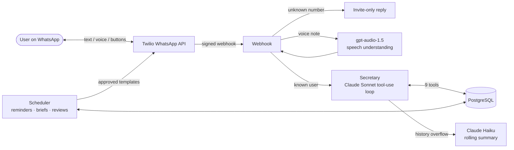

# WhatsApp AI Secretary

[العربية](README.ar.md)

A personal secretary that lives in WhatsApp. Write or speak to it in English or Arabic, and it schedules your tasks, reminds you before they happen, and sends you a morning and evening brief of your day, plus a review at the end of the week.

> **Status:** live in an invite-only beta with 4 users, improved continuously from their feedback. The source is private: [request a test invite or code access](#try-it).

## What it does

- **Task management:** "ذكرني بكرة الساعة خمس إلا ربع عندي اختبار كيمياء" or "push gym to tomorrow" creates, reschedules, completes or deletes tasks. No forms, no commands.
- **Voice notes:** send a voice note instead of typing, and it does the same things: add a task, move it, mark it done.
- **Daily and weekly briefs:** a morning brief of the day, reminders before each task, an evening summary of what got done or missed, and a review at the end of the week.
- **Recurring tasks:** "every Friday after Isha" becomes a real recurrence rule, while replies still quote your own words.
- **One-tap replies:** reminders carry Done / Reschedule / Decide later buttons, and typing works just as well.

## Architecture

Inbound messages arrive through a signed Twilio webhook. Unknown numbers get a short invite-only reply before any paid API call. For known users, voice notes are understood by an audio-native model, and the message goes to the secretary: a Claude tool-use loop whose only way to change anything is through backend tools. A separate scheduler sends everything proactive (reminders, briefs, reviews) as Meta-approved templates, the only kind of message WhatsApp allows outside a 24-hour conversation window.

## Engineering highlights

### Tool calling (function calling)
The model never changes data through its own text. It is given a set of tools, each with a name, a description and an input schema, and it decides which tool fits the user's request from those descriptions. The backend runs the tool and the result goes back to the model.
- **9 tools:** create, list, complete, reopen, reschedule, delete, update, preferences, plus an action gate. The model is instructed never to describe an action as done unless a tool returned success.
- **The backend writes the confirmations.** "Task created" or "moved to 5 PM" messages are built from the committed database row after the transaction, not from the model's prose, so what the user reads is what was actually saved.
- **Unsupported requests are handled by the system, not the model.** The model must declare the action type first. If no tool backs it, the backend sends a fixed "can't do that yet" reply instead of letting the model improvise.
### Rolling conversation memory
The most recent messages (up to 20) stay in the model's context, so replies follow the conversation naturally. When the history grows past that, older turns are folded into a running summary by Claude Haiku instead of being dropped. The summary keeps preferences, people and open questions, and leaves out task details, which the model reads fresh from the database through its tools.

### Built for Gulf Arabic
- **Time grammar.** "الساعة ٣ إلا ربع" is 2:45 and "بعد نص ساعة" is 30 minutes from now. These resolve directly.
- **Number vs time ambiguity.** "ثلاثة وأربعين" can be 3:40 or the number 43. The secretary resolves it from context and asks exactly one question when context can't decide, instead of silently guessing a time.
- **Audio-native voice understanding.** Voice notes go to an audio-native model (gpt-audio-1.5) rather than a speech-to-text model. It understands the speech as a whole, so it keeps the Gulf dialect, mixed-in English words and mid-sentence corrections that a transcription model dropped in testing. WhatsApp's OGG/Opus audio is decoded to WAV in-process.

### Scheduling that matches real life
- **Recurrence stored twice, on purpose.** Each recurring task keeps a machine-readable RRULE (`FREQ=WEEKLY;BYDAY=FR`) for scheduling and the user's original phrase for replies. Occurrences share a series id, so "skip this one" and "cancel all of them" are both precise operations.
- **"Missed" is a default, not a declaration.** A clock-driven job marks overdue pending tasks as missed, so silence resolves cleanly. A later "done" simply overrides it.
- **Timezone-correct, idempotent briefs.** Morning, evening and weekly messages fire at each user's local preferred time, are recorded per day so they never send twice, and skip stale catch-up after downtime instead of sending a morning brief at noon.
- **Reminders re-check reality.** A reminder for a task that has since been completed, deleted or made timeless is cancelled at send time rather than firing.

### Working within WhatsApp's rules
- **Templates vs free-form.** Proactive messages use approved bilingual templates with quick-reply buttons. Replies inside the 24-hour window are free-form.
- **Reply threading.** A reply to a specific reminder is tied back to that task, so "done" needs no "which one?".
- **No duplicate deliveries.** Outbound sending never raises into the webhook, because a server error would make Twilio redeliver the inbound message and repeat the work. Long replies are split on line boundaries under the per-message limit.

## Tech stack

| Layer | Choice |
|---|---|
| Language | Python 3.13, Flask, SQLAlchemy, APScheduler |
| Conversation | Claude Sonnet 4.6 (tool use), Claude Haiku 5.5 (summaries) |
| Voice | OpenAI gpt-audio-1.5, PyAV for audio decoding |
| Messaging | Twilio WhatsApp Business API, Meta-approved templates |
| Data | PostgreSQL, RRULE recurrence (python-dateutil) |
| Hosting | Railway |

## Roadmap

- [x] Task management by text or voice (Arabic / English / mixed)
- [x] Reminders, morning brief, evening summary, weekly review
- [x] Recurring tasks
- [x] Rolling conversation memory
- [ ] Follow-up on ignored reminders for urgent tasks
- [ ] "Running late" nudge when the current task overruns into the next
- [ ] Self-service sign-up page

## Try it

The bot is in an invite-only beta, and the source code is private.

📧 **contact@talal-alqahtani.com**: request a test invite or access to the code
💼 [LinkedIn](https://www.linkedin.com/in/talal-alqahtani-677b25397/)

Built by **Talal AlQahtani**.
